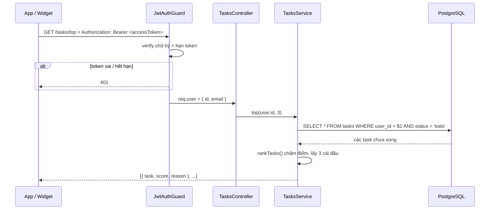

# 01 · Kiến trúc backend

## Stack

| Thành phần | Chọn | Lý do |
|---|---|---|
| Framework | NestJS 11 (TypeScript) | Đã có sẵn từ trước, có test và Swagger, widget đang gọi. Giữ nguyên thay vì viết lại. |
| Database | PostgreSQL 16 | Dữ liệu có quan hệ rõ (user, task, capture), cần transaction khi xác nhận capture. |
| ORM | TypeORM 0.3 + `@nestjs/typeorm` 11 | Tích hợp sẵn với Nest (inject repository), có migration. |
| Auth | `@nestjs/jwt` 11 + `bcryptjs` | JWT cho access token, bcrypt băm mật khẩu. `bcryptjs` viết bằng JS thuần, không cần build native trên Windows. |
| Chạy local | Docker Compose | Mọi người có cùng một Postgres, không phải cài tay. |

**Vì sao pin bản 11 / 0.3 mà không lên bản mới nhất?** `@nestjs/typeorm` 12 và `@nestjs/jwt` 12 là ESM-only (thế hệ Nest 12), project đang là Nest 11 + CommonJS nên Jest không load được. TypeORM 1.x mới ra, 0.3 là bản ổn định đã dùng rộng rãi. Khi cả nhóm lên Nest 12 thì nâng cùng lúc.

## Cấu trúc thư mục `backend/src`

```text
src/
├── main.ts              # khởi động server: đọc .env, kiểm tra biến môi trường, listen
├── setup.ts             # cấu hình dùng chung cho server và test: validation, CORS, Swagger
├── app.module.ts        # ghép các module lại
├── app.controller.ts    # GET /health (kiểm tra cả database), GET / chuyển sang /docs
├── config/              # đọc và kiểm tra biến môi trường (env.ts), đọc file .env (dotenv.ts)
├── database/            # kết nối TypeORM, data source cho CLI, migration, seed tài khoản demo
├── users/               # entity và service cho bảng users
├── auth/                # đăng ký, đăng nhập, refresh, logout, guard JWT toàn cục
├── tasks/               # CRUD task, Top 3 (ranking.ts giữ nguyên)
└── captures/            # tách câu thành task nháp (parser giữ nguyên), xác nhận, bỏ qua
```

## Một request đi qua những đâu

Ví dụ `GET /tasks/top` từ app:



## Các quyết định thiết kế đáng chú ý

**Guard toàn cục, mặc định phải đăng nhập.** `JwtAuthGuard` đăng ký bằng `APP_GUARD`, nên endpoint mới thêm vào sẽ tự được bảo vệ. Muốn công khai thì phải gắn `@Public()` một cách có chủ đích (hiện chỉ có `/health`, `/`, và `/auth/register|login|refresh|logout`). Làm ngược lại (mặc định công khai) thì quên gắn guard một lần là lộ dữ liệu.

**`userId` luôn lấy từ token, không bao giờ từ body.** Validation đang bật `forbidNonWhitelisted`, nên gửi `userId` trong body bị trả `400`. Mọi hàm trong service nhận `userId` làm tham số đầu tiên và luôn có điều kiện `WHERE user_id = ...`.

**Task của người khác trả `404`, không phải `403`.** `403` sẽ tiết lộ "id này có tồn tại, nhưng không phải của bạn". `404` thì người ngoài không phân biệt được.

**Xếp hạng Top 3 vẫn làm trong code, không viết bằng SQL.** Một sinh viên có cỡ vài chục task chưa xong, kéo hết về rồi chấm điểm là đủ nhanh. Đổi lại công thức nằm ở một chỗ (`ranking.ts`), test được bằng unit test, và giải thích được cho user ("Xếp trước vì..."). Nếu sau này cần phân trang hàng nghìn task thì mới cân nhắc đẩy xuống SQL.

**Hợp đồng API giữ nguyên.** Entity dùng `Date`, nhưng hàm `toTask()` / `toCapture()` đổi về đúng dạng JSON cũ (ngày giờ là chuỗi ISO). Ngoài việc phải gửi token, client cũ không phải sửa gì về định dạng dữ liệu.
