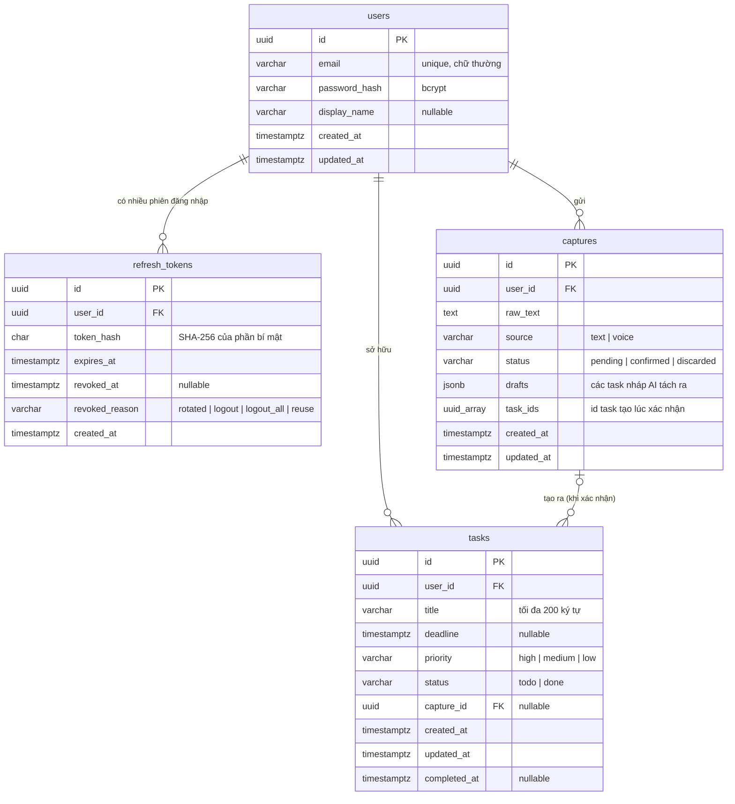

# 02 · Database (PostgreSQL)

## Sơ đồ bảng



## Giải thích các lựa chọn

| Chỗ | Chọn | Vì sao |
|---|---|---|
| Khóa chính | `uuid` (`gen_random_uuid()`) | API cũ đã dùng UUID (`ParseUUIDPipe`), giữ nguyên. Không đoán được id kế tiếp như số tự tăng. |
| Thời gian | `timestamptz` | Luôn lưu theo UTC, tránh lỗi lệch giờ khi server Render ở Mỹ còn user ở Việt Nam. |
| `priority`, `status`, `source` | `varchar` + `CHECK` | Postgres `ENUM` khó đổi về sau (thêm giá trị mới phải migration riêng, không xóa được). `CHECK` vẫn chặn giá trị rác ở tầng DB. |
| `drafts` của capture | `jsonb` | Luôn đọc/ghi cả cụm, không bao giờ truy vấn từng task nháp, nên không cần bảng riêng. |
| `task_ids` của capture | `uuid[]` | Giữ đúng ngữ nghĩa cũ: danh sách id lúc xác nhận, không đổi kể cả khi task bị xóa sau đó. |
| Xóa user | `ON DELETE CASCADE` | Xóa tài khoản thì xóa sạch dữ liệu của người đó. |
| Xóa capture | `tasks.capture_id ON DELETE SET NULL` | Task là thứ user quan tâm, capture chỉ là nguồn gốc. |

## Index

| Index | Phục vụ truy vấn |
|---|---|
| `UQ_users_email` (unique) | Đăng nhập theo email, chặn đăng ký trùng (kể cả 2 request song song) |
| `IDX_tasks_user_status` (`user_id`, `status`) | Top 3 và danh sách task, truy vấn nóng nhất |
| `IDX_tasks_capture` | Tìm task theo capture, và để FK `SET NULL` không phải quét cả bảng |
| `IDX_captures_user_created` (`user_id`, `created_at`) | Danh sách capture mới nhất trước |
| `IDX_refresh_tokens_user` | Thu hồi mọi phiên của một user |

## Migration

Schema **chỉ** được thay đổi qua migration (`synchronize: false`). Lý do: `synchronize` tự sửa bảng theo entity, có thể âm thầm xóa cột cùng dữ liệu trên production, và mỗi máy dev có thể ra schema khác nhau.

Migration hiện có: `src/database/migrations/1730700000000-InitSchema.ts` (tạo 4 bảng). Server tự chạy migration còn thiếu mỗi lần khởi động (`DB_RUN_MIGRATIONS=true`), nên deploy Render chỉ cần push code.

Entity khai báo đủ tên PK/FK/index/check trùng với migration. Đã kiểm tra bằng `migration:generate`: TypeORM báo **"No changes in database schema were found"**, tức entity và migration khớp nhau hoàn toàn.

### Khi cần đổi schema (ví dụ thêm cột `notes` vào `tasks`)

```bash
cd backend
# 1. Sửa entity (src/tasks/task.entity.ts)
# 2. Để TypeORM so entity với database và sinh migration
npm run migration:generate -- src/database/migrations/AddTaskNotes
# 3. Đọc kỹ file vừa sinh, rồi thêm class đó vào mảng MIGRATIONS trong src/database/typeorm.options.ts
# 4. Chạy thử
npm run migration:run
npm run migration:revert   # thử quay lại được không
npm run migration:run
```

> **Không sửa migration đã merge vào `develop`.** Máy người khác và server đã chạy nó rồi, sửa lại thì schema mỗi nơi một kiểu. Muốn đổi thì viết migration mới.

Migration được liệt kê tường minh trong `MIGRATIONS` (không dùng glob `*.ts`) để chạy giống nhau ở ts-node, Jest và bản build trong Docker.

## Xem dữ liệu bằng tay

```bash
docker exec -it 3next-db psql -U next -d next3
\dt                                   -- liệt kê bảng
SELECT email, created_at FROM users;
SELECT title, priority, status, deadline FROM tasks ORDER BY created_at DESC LIMIT 10;
```

Hoặc dùng DBeaver / TablePlus / pgAdmin nối tới `localhost:5432`, user `next`, mật khẩu `next`, database `next3`.
