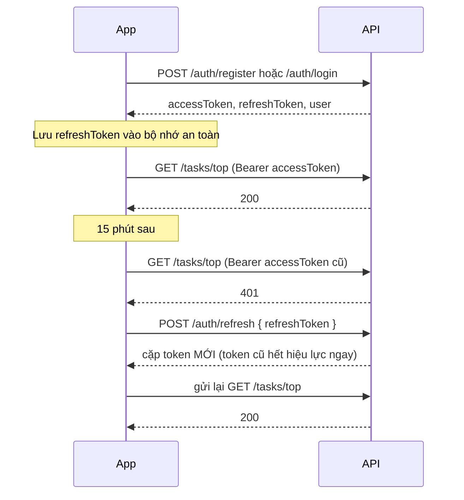

# 03 · Đăng nhập (email + mật khẩu, JWT)

## Mục tiêu

Dữ liệu nằm trên server trung tâm và gắn với tài khoản, nên đổi điện thoại hay cài lại app chỉ cần đăng nhập lại là có đủ task.

## Hai loại token

| | Access token | Refresh token |
|---|---|---|
| Dạng | JWT (HS256), ký bằng `JWT_SECRET` | Chuỗi ngẫu nhiên `"<id>.<bí mật>"` |
| Sống | 15 phút (`JWT_ACCESS_TTL_SECONDS`) | 30 ngày (`REFRESH_TOKEN_TTL_DAYS`) |
| Dùng để | Gắn vào mọi request: `Authorization: Bearer <accessToken>` | Chỉ gửi tới `POST /auth/refresh` và `/auth/logout` |
| Server lưu gì | Không lưu (kiểm tra bằng chữ ký) | Chỉ lưu SHA-256 của phần bí mật |
| Thu hồi được không | Không, phải chờ hết hạn (nên để ngắn) | Được, đăng xuất là hết hiệu lực ngay |

**Vì sao không dùng một token sống 30 ngày cho gọn?** JWT không thu hồi được. Lỡ lộ một token 30 ngày thì người khác dùng được 30 ngày, đăng xuất cũng vô ích. Access token ngắn + refresh token thu hồi được là cách phổ biến cho app mobile.

**Vì sao chỉ lưu hash của refresh token?** Lỡ lộ database (backup, ảnh chụp màn hình bảng) thì người khác vẫn không có token gốc để dùng.

## Luồng

## Rotation và phát hiện token bị lộ

Mỗi lần `POST /auth/refresh` thành công, refresh token cũ bị đánh dấu `revoked_reason = 'rotated'` và client nhận token mới.

Nếu sau đó có ai gửi lại **đúng cái token đã rotate**, khả năng cao là token đã bị sao chép (người thật thì đã có token mới). Khi đó server thu hồi **mọi phiên** của tài khoản đó và buộc đăng nhập lại.

Token bị thu hồi vì **đăng xuất** (`logout`) thì không kích hoạt cơ chế này. Lý do: lúc đầu mình làm chung một kiểu, và test bắt được lỗi là đăng xuất trên điện thoại rồi app lỡ gửi lại token cũ thì laptop cũng bị đá văng theo. Xem [nhat-ky.md](nhat-ky.md).

Hai request refresh cùng lúc với cùng một token: câu lệnh thu hồi có điều kiện `WHERE revoked_at IS NULL`, nên chỉ một request thắng, request kia nhận `401`.

## Các chi tiết bảo mật khác

- Mật khẩu băm bằng bcrypt (cost 10), không bao giờ trả về trong API.
- Email luôn được bỏ khoảng trắng và đưa về chữ thường trước khi kiểm tra và lưu. `Khoa@HCMUT.edu.vn ` và `khoa@hcmut.edu.vn` là cùng một tài khoản.
- Sai mật khẩu và email không tồn tại trả **cùng một thông báo** `401`. Khi email không tồn tại, server vẫn chạy bcrypt với một hash giả để thời gian phản hồi xấp xỉ nhau, người ngoài khó dò email nào đã đăng ký.
- Mật khẩu 8 đến 72 ký tự (bcrypt chỉ dùng 72 byte đầu).
- `verifyOptions.algorithms = ['HS256']`: không chấp nhận token ký bằng thuật toán khác (chặn kiểu tấn công `alg: none`).
- Trên production, server **không khởi động** nếu thiếu `JWT_SECRET` hoặc khóa ngắn hơn 32 ký tự.

## Chưa làm (cố ý để sau)

- Giới hạn số lần đăng nhập sai (rate limit). Nên thêm `@nestjs/throttler` trước khi cho người thật dùng.
- Quên mật khẩu / xác thực email: cần dịch vụ gửi mail.
- Đăng nhập Google.
- Dọn refresh token đã hết hạn (hiện chỉ tích lũy, mỗi lần đăng nhập thêm một dòng nhỏ, chưa đáng lo ở quy mô môn học).

## Cách client mobile nên làm

1. Đăng nhập xong lưu `refreshToken` vào bộ nhớ an toàn (React Native: `expo-secure-store` hoặc `react-native-keychain`). `accessToken` để trong bộ nhớ là đủ.
2. Gắn `Authorization: Bearer <accessToken>` cho mọi request (một interceptor của axios/fetch wrapper).
3. Gặp `401` thì gọi `POST /auth/refresh` **một lần**, lưu cặp token mới, gửi lại request. Refresh cũng `401` thì đưa về màn hình đăng nhập.
4. Nhiều request cùng gặp `401` thì chỉ refresh một lần, các request khác chờ kết quả đó (nếu mỗi request tự refresh, request thứ hai sẽ dùng lại token đã rotate và kích hoạt cơ chế "token bị lộ", đá văng mọi phiên).
5. Đăng xuất: gọi `POST /auth/logout { refreshToken }` rồi xóa token trên máy.

Thử nhanh trên Swagger: `/docs` → `POST /auth/register` → copy `accessToken` → nút **Authorize** → dán vào.
